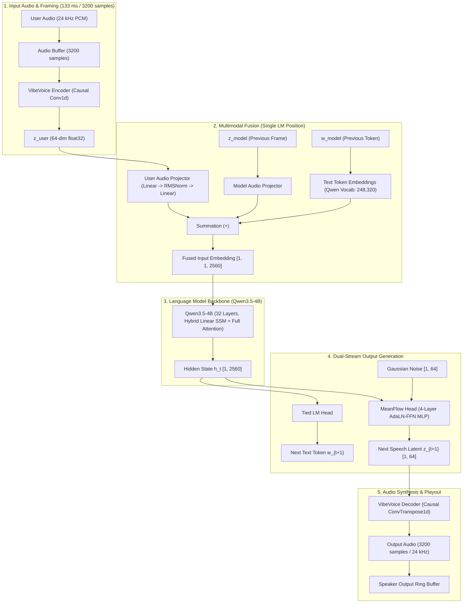

# Haru-4B: Architecture Deep Dive

This document details the internal architecture, mathematical formulations, tensor dimensions, and execution flow of **Haru-4B**, highlighting the critical pathways required to port and quantize the model.

---

## 1. High-Level System Architecture

Unlike traditional turn-based voice AI (which cascades Speech-to-Text $\to$ LLM $\to$ Text-to-Speech), Haru-4B is a **native full-duplex Continuous Spoken Dialogue Model**. It processes incoming speech and synthesizes outgoing speech in lockstep at **7.5 Hz (133.33 ms per frame)**.

---

## 2. Mathematical Formulations & Component Specifications

### A. The 7.5 Hz Temporal Framing
* **Audio Sample Rate:** $f_s = 24,000 \text{ Hz}$
* **Frame Size ($N$):** $3,200 \text{ samples}$
* **Temporal Resolution:**
  $$\Delta t = \frac{3,200}{24,000} \text{ s} = \frac{2}{15} \text{ s} \approx 133.33 \text{ ms}$$
* **Frame Rate:**
  $$f_{\text{frame}} = \frac{1}{\Delta t} = 7.5 \text{ Hz}$$

Every 133.33 ms, the model consumes exactly one frame and produces exactly one frame. For real-time conversational streaming, total end-to-end pipeline latency must remain strictly below $133.33 \text{ ms}$.

---

### B. VibeVoice Causal Acoustic Codec
The codec converts continuous 24 kHz audio into a compact 64-dimensional latent vector and vice versa.
* **Latent Dimension:** $D = 64$
* **Downsampling Strides:** `ratios = [8, 5, 5, 4, 2, 2]`
  $$\text{Total Downsampling Factor} = 8 \times 5 \times 5 \times 4 \times 2 \times 2 = 3,200$$
* **Causal Streaming State:**
  To allow per-frame streaming without whole-file context, every `CausalConv1d` layer maintains explicit left context memory:
  $$\text{Context Size} = K - S$$
  where $K$ is convolution kernel size and $S$ is stride.
* **Quantization Recommendation:** **FP16**. Quantizing neural vocoders / audio tokenizers down to 4-bit introduces heavy high-frequency quantization noise and metallic timbre artifacts.

---

### C. Multimodal Embedding Fusion
Standard language models accept token indices $w \in \mathbb{N}$ and perform a dictionary lookup $E(w) \in \mathbb{R}^{d}$. In Haru-4B, each timestep fuses text, user audio, and model self-audio into a single LM position:

$$\mathbf{x}_t = \mathbf{E}(w_t) + \mathbf{W}_2^{(u)} \left( \text{RMSNorm}\left(\mathbf{W}_1^{(u)} \mathbf{z}_t^{(u)}\right) \right) + \mathbf{W}_2^{(m)} \left( \text{RMSNorm}\left(\mathbf{W}_1^{(m)} \mathbf{z}_t^{(m)}\right) \right)$$

where:
* $\mathbf{z}_t^{(u)} \in \mathbb{R}^{64}$ is the normalized user audio latent.
* $\mathbf{z}_t^{(m)} \in \mathbb{R}^{64}$ is the model's previous audio latent.
* $w_t \in \{0, \dots, 248319\}$ is the model's previous text token.
* $\mathbf{x}_t \in \mathbb{R}^{2560}$ is the combined input vector fed into the backbone using `inputs_embeds`.

---

### D. Qwen3.5-4B Hybrid Backbone
The core sequence model is based on Qwen3.5 with 32 layers:
* **Hidden Size ($H$):** $2560$
* **Intermediate Size:** $9216$
* **Attention Heads:** 16 query heads, 4 key/value heads (Grouped Query Attention)
* **Hybrid Attention Pattern:**
  Haru uses an interleaved hybrid structure: 3 linear attention (Mamba SSM) layers followed by 1 standard full attention layer, repeated 8 times:
  $$\text{Interval} = 4 \implies [ \text{Linear, Linear, Linear, Full} ] \times 8$$
* **Max Context:** 262,144 tokens with partial rotary factor (RoPE $\theta = 10,000,000$).
* **Quantization Recommendation:** **GGUF Q4_K_M** (~2.5 GB) or **Q8_0** (~4.3 GB). The backbone accounts for >95% of total parameters and memory footprint.

---

### E. MeanFlow Continuous Audio Head
Instead of predicting discrete token IDs or running multi-step diffusion (which requires 20–50 forward passes), Haru uses a **1-step MeanFlow ODE generator**:
* The head estimates the mean velocity $\mathbf{u}(\mathbf{z}, t, h \mid \mathbf{c}, w)$ of flow from standard normal noise $\mathbf{z}_0 \sim \mathcal{N}(0, \mathbf{I})$ to data $\mathbf{z}_1$:
  $$\mathbf{z}_{t+1} = \mathbf{z}_0 + h \cdot \mathbf{u}(\mathbf{z}_0, \mathbf{c}, t=0, h=1, w)$$
* **Conditioning ($\mathbf{c}$):** Projected from LM hidden state $\mathbf{h}_t \in \mathbb{R}^{2560}$ along with sinusoidal scalar embeddings for timestep $t$, step size $h$, and guidance scale $w$ ($w \in [1.0, 2.0]$, default $1.5$).
* **Network Structure:** 4 AdaLN (Adaptive LayerNorm) feed-forward layers with expansion ratio 3.0.
* **Execution Time:** Single forward pass takes $< 2 \text{ ms}$ on modern hardware.

---

## 3. Tensor Dimensions Summary

| Component | Tensor Name | Parameter Count | Shape | Data Type (Source) | Quantization Target |
| :--- | :--- | :--- | :--- | :--- | :--- |
| **LM Embeddings** | `lm.embed_tokens.weight` | ~635 M | `[248320, 2560]` | BF16 | Q4_K_M / Q8_0 |
| **LM Backbone** | `lm.layers.*` | ~3.3 B | Varies | BF16 | Q4_K_M |
| **Audio Projectors** | `model_audio_proj.*`, `user_audio_proj.*` | ~13 M | `[2560, 64]`, `[2560, 2560]` | BF16 | FP16 |
| **MeanFlow Head** | `head.layers.*`, `head.final.*` | ~45 M | `[7680, 2560]`, etc. | BF16 | FP16 |
| **VibeVoice Codec** | `codec.encoder.*`, `codec.decoder.*` | ~85 M | Causal 1D Conv weights | BF16 | FP16 |
| **Total Model** | | **~4.08 Billion** | | **~10.5 GB** | **~2.8 GB (Hybrid)** |
