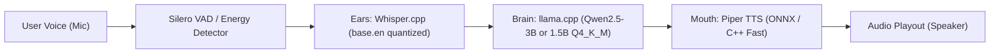

# Cascaded CPU Voice Pipeline: Low-Cost Turn-Based Alternative

If your budget is constrained to a cheap **Linode Shared CPU server ($10–$24/month)** where full-duplex Haru-4B cannot run in real time, deploy this **3-stage cascaded CPU pipeline**.

---

## 1. Architecture Comparison

| Feature | Full-Duplex Haru-4B | Cascaded CPU Pipeline (Whisper + Llama + Piper) |
| :--- | :--- | :--- |
| **Dialogue Nature** | Simultaneous (talk over, backchannel, interrupt) | Turn-based (User speaks $\to$ pauses $\to$ AI responds) |
| **Minimum Hardware** | 16-core Dedicated EPYC CPU or 12GB GPU | **2–4 vCPU Shared Linode ($12–$24/mo)** |
| **Memory Bandwidth Requirement** | > 18.75 GB/s sustained | < 8 GB/s burst |
| **End-to-End Latency** | 133 ms per frame continuous | **~350–550 ms response delay after silence** |
| **Components** | 1 unified LSLM foundation model | 3 lightweight modular C++ tools |

---

## 2. The 3-Part Modular Stack



### Stage 1: Ears — `whisper.cpp` (Speech-to-Text)
* **Model:** `ggml-base.en-q5_1.bin` (~57 MB) or `ggml-tiny.en.bin` (~39 MB).
* **Speed:** Transcribes a 3-second audio utterance in **~60–100 ms** on 2–4 CPU cores using AVX2.
* **Source:** [ggerganov/whisper.cpp](https://github.com/ggerganov/whisper.cpp)

### Stage 2: Brain — `llama.cpp` (Language Model)
* **Model:** `Qwen2.5-3B-Instruct-Q4_K_M.gguf` (~2.0 GB) or `Llama-3.2-3B-Instruct-Q4_K_M.gguf`.
* **Speed:** Generation speed: **25–40 tokens/second** on modern server CPUs.
* **Prompting:** Instructed to produce concise, conversational sentences suited for speech synthesis.
* **Source:** [ggml-org/llama.cpp](https://github.com/ggml-org/llama.cpp)

### Stage 3: Mouth — `Piper TTS` (Text-to-Speech)
* **Model:** Piper ONNX voice model (e.g. `en_US-lessac-medium` or `en_US-amy-medium`, ~60 MB).
* **Speed:** Real-Time Factor (RTF) of **0.05–0.1x** (generates 1 second of speech in 50–100 ms on CPU).
* **Source:** [rhasspy/piper](https://github.com/rhasspy/piper)

---

## 3. End-to-End Turn-Based Latency Breakdown

1. User finishes sentence (Silence detection / VAD): **~150 ms**
2. Whisper.cpp processes utterance: **~80 ms**
3. llama.cpp generates first 5 tokens: **~50 ms**
4. Piper synthesizes first clause to audio: **~60 ms**
5. **Total time to first sound:** **~340 ms** (Indistinguishable from a natural conversational pause).

---

## 4. Running the Included Cascaded Pipeline Runner

A complete working runner is available in this repository under:
`models/haru-4b/cascaded_pipeline/run_pipeline.py`.

```bash
cd models/haru-4b/cascaded_pipeline
python run_pipeline.py --help
```
