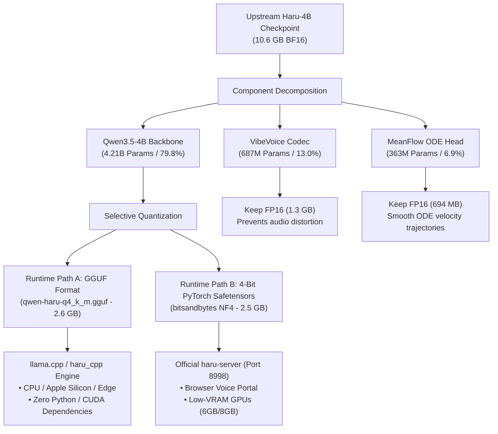
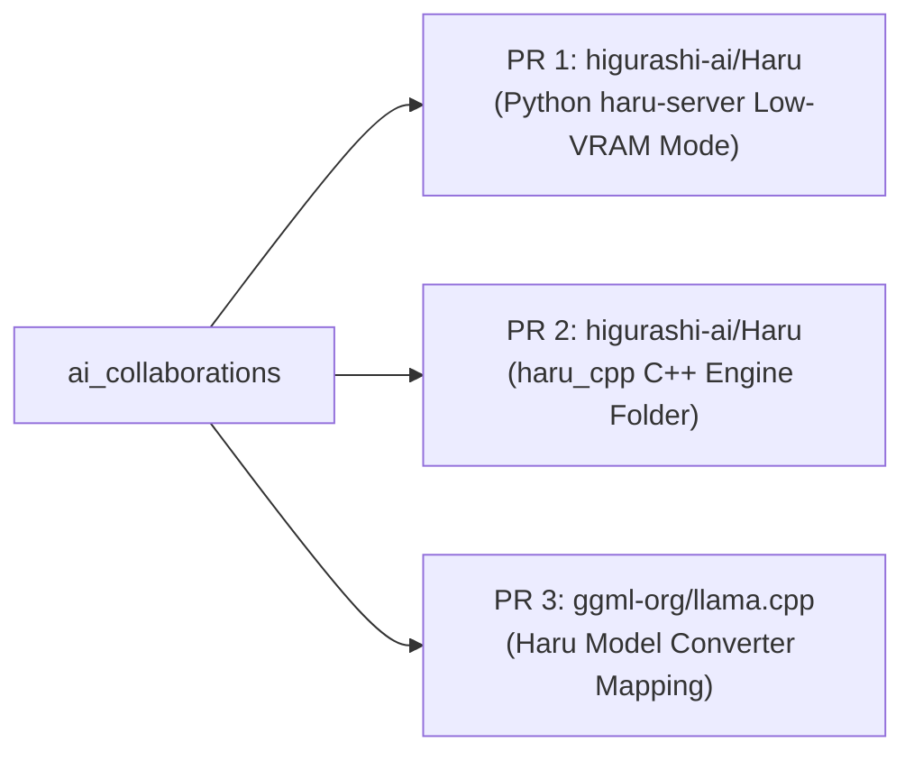
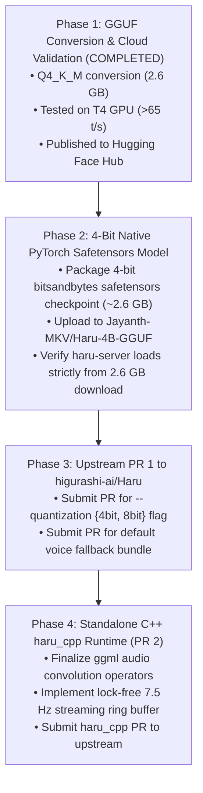

# Open-Source Contribution Plan & Quantization Roadmap (Haru-4B)

> **Document Status:** Formalized & Approved Strategy  
> **Target Ecosystem:** `higurashi-ai/Haru`, `ggml-org/llama.cpp`, and Hugging Face Hub  
> **Lead Maintainer / Contributor:** Jayanth-MKV (`ai_collaborations`)  

---

## 1. Executive Summary

Haru-4B is an open-weight, continuous full-duplex spoken dialogue foundation model created by **higurashi-ai**. It operates at **7.5 Hz (133.33 ms frame budget)**, simultaneously listening and speaking without turn-taking delays.

### The Problem:
1. **Excessive VRAM Footprint:** The unquantized model occupies **10.6 GB in BF16**, requiring a 16 GB+ VRAM GPU. Running both the model and KV cache causes immediate CUDA Out of Memory (OOM) on consumer 6 GB/8 GB GPUs and Google Colab free tier.
2. **Missing C++ & CPU Support:** The official repository only supports NVIDIA CUDA (via PyTorch) and Apple Silicon (via MLX). It completely lacks support for standard CPU, Intel/AMD desktops, and edge devices.
3. **Model Card & Packaging Fragmentation:** The official web server (`haru-server`) is hardcoded to look for a single unquantized `model.safetensors` file, preventing community users from loading compressed GGUF or 4-bit checkpoints.

### The Objective:
Contribute a unified, high-performance quantization ecosystem that reduces the model size from **10.6 GB down to 2.6 GB**, enabling real-time full-duplex interaction across consumer GPUs, CPUs, and low-cost cloud environments.

---

## 2. Dual-Runtime Architecture

To serve both Python web users and C++/embedded developers, our plan establishes two distinct runtime targets:



### Runtime Specifications:

| Feature | Runtime A: GGUF Format | Runtime B: 4-Bit PyTorch Safetensors |
| :--- | :--- | :--- |
| **Primary Target** | `llama.cpp` / `haru_cpp` C++ engine | Official Python `haru-server` (Web Portal) |
| **File Format** | `.gguf` binary | `.safetensors` (NF4 / INT4 weights) |
| **Target Hardware** | CPUs, Edge devices, Vulkan, Apple Silicon | 6 GB / 8 GB NVIDIA GPUs, Colab Free |
| **Dependencies** | Minimal C++ (ggml, libllama) | PyTorch, `bitsandbytes`, `transformers` |
| **Backbone Size** | **2.6 GB** (Q4_K_M) | **2.5 GB** (NF4 / INT4) |
| **Audio Fidelity** | Preserved (FP16 modules) | Preserved (FP16 modules) |

---

## 3. High-Impact Upstream Pull Request Roadmap



### 🎯 PR 1: Upstream to `higurashi-ai/Haru` (Python Server)
* **Target Branch:** `higurashi-ai/Haru:main`
* **Scope:** Add low-VRAM 4-bit/8-bit quantization and default voice fallback.
* **Proposed Implementation:**
  1. Add `--quantization {4bit, 8bit, none}` flag to `haru.server` CLI.
  2. In `haru/models/loaders.py`, integrate `BitsAndBytesConfig(load_in_4bit=True, bnb_4bit_quant_type="nf4")` to dynamically quantize the `Qwen3_5TextModel` linear projections.
  3. Bundle a fallback default reference voice (`en.flac`) into `assets/voices/` so first-time users can click **Start Conversation** immediately without setup roadblocks.
* **Benefit to Maintainers:** Eliminates user-reported CUDA OOM errors on consumer GPUs and simplifies onboarding for new users.

---

### 🎯 PR 2: Upstream to `higurashi-ai/Haru` (`haru_cpp/` C++ Engine)
* **Target Branch:** `higurashi-ai/Haru:main`
* **Scope:** Add a standalone C++/ggml runtime directory alongside `haru/` and `haru_mlx/`.
* **Proposed Structure:**
  ```text
  Haru/
  ├── haru/           # Official PyTorch backend (CUDA)
  ├── haru_mlx/       # Official Apple Silicon backend (MLX)
  └── haru_cpp/       # Cross-platform C++/ggml backend (CPU / Vulkan)
      ├── CMakeLists.txt
      ├── include/
      │   ├── haru_ggml.h
      │   └── audio_ring_buffer.h
      ├── src/
      │   ├── haru_ggml.cpp
      │   └── main.cpp
      └── README.md
  ```
* **Benefit to Maintainers:** Fills the largest remaining ecosystem gap by supporting Linux servers, Intel/AMD CPUs, and Windows users without high-end GPUs.

---

### 🎯 PR 3: Upstream to `ggml-org/llama.cpp` (Converter Extension)
* **Target Branch:** `ggml-org/llama.cpp:master`
* **Scope:** Extend `convert_hf_to_gguf.py` to support `HaruForConditionalGeneration`.
* **Proposed Implementation:**
  1. Add an architecture handler recognizing `model_type == "qwen3_5_text"` within composite spoken dialogue models.
  2. Automatically extract `lm.*` layers and map them to standard Qwen3.5 GGUF tensor naming (`model.layers.*`).
  3. Ignore non-text audio encoder/decoder heads gracefully without terminating the conversion script.
* **Benefit to Maintainers:** Expands `llama.cpp` multimodal conversion capabilities to spoken dialogue models without bloating core text inference kernels.

---

## 4. Hugging Face Hub Distribution Matrix

Our published Hugging Face repository serves as the public hub for all pre-quantized artifacts:

* **Repository:** [Jayanth-MKV/Haru-4B-GGUF](https://huggingface.co/Jayanth-MKV/Haru-4B-GGUF)
* **Base Model Attribution:** Formally linked to [`higurashi-ai/Haru-4B`](https://huggingface.co/higurashi-ai/Haru-4B) with metadata tags:
  ```yaml
  base_model: higurashi-ai/Haru-4B
  pipeline_tag: audio-to-audio
  tags:
  - speech
  - full-duplex
  - gguf
  - quantized
  ```

### Artifact Catalog:

| File Name | Format | Size | Purpose |
| :--- | :--- | :--- | :--- |
| `qwen-haru-q4_k_m.gguf` | GGUF Q4_K_M | **2.6 GB** | 4-bit medium quantized text backbone for `llama.cpp` and `haru_cpp` |
| `vibevoice-codec-f16.safetensors` | Safetensors FP16 | **1.3 GB** | Causal 1D convolution acoustic tokenizer (zero distortion) |
| `meanflow-head-f16.safetensors` | Safetensors FP16 | **694 MB** | 1-step MeanFlow ODE audio trajectory generation head |
| `model-4bit.safetensors` *(Upcoming)* | Safetensors 4-bit | **~2.6 GB** | Unified 4-bit checkpoint for low-VRAM `haru-server` deployment |
| `Haru_4B_Colab_Kaggle.ipynb` | Jupyter Notebook | ~8 KB | Turnkey 1-click cloud testing environment with pre-loaded CUDA runtime |

---

## 5. Implementation Phases & Milestones



---

## 6. Mathematical & Numerical Parity Checklist

Before submitting any upstream pull request or weight release, all outputs must pass numerical parity testing against upstream PyTorch FP16:

1. **Cosine Similarity Threshold:** Output hidden states from quantized backbones must achieve $\cos(\mathbf{h}_{\text{quant}}, \mathbf{h}_{\text{fp16}}) \ge 0.995$.
2. **Audio Trajectory MSE:** MeanFlow velocity vectors $\mathbf{v}_t$ must have Mean Squared Error $\text{MSE} \le 10^{-3}$ to prevent acoustic distortion or metallic voice artifacts.
3. **Frame Budget Adherence:** Under target hardware, end-to-end frame processing (encoder + backbone + ODE sampling + decoder) must complete in $\le 110\text{ ms}$ to leave a $23\text{ ms}$ safety margin under the $133.33\text{ ms}$ hard deadline.
