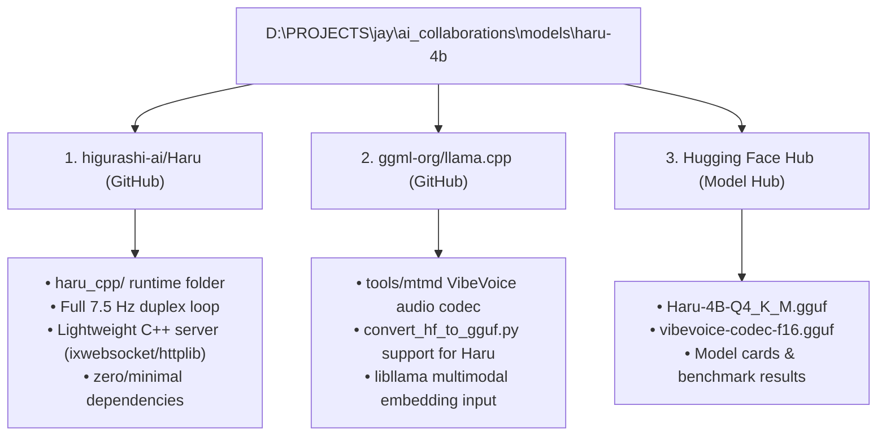

# Open Source Pull Request & Contribution Strategy for Haru-4B

This guide outlines the upstream contribution strategy for publishing C++/ggml implementations and quantized weights of Haru-4B to the open-source community.

---

## 1. Upstream Repositories & Scopes



---

## 2. Target 1: `higurashi-ai/Haru` (Primary Target)

### Proposed Contribution:
Add a native, dependency-free C++/ggml inference runtime directory: `haru_cpp/` alongside the existing `haru/` (PyTorch) and `haru_mlx/` (Apple Silicon MLX) folders.

### Upstream Directory Integration:
```text
Haru/
├── haru/           # Official PyTorch backend
├── haru_mlx/       # Official Apple Silicon MLX backend
└── haru_cpp/       # OUR PR: Cross-platform C++/ggml backend
    ├── CMakeLists.txt
    ├── include/
    │   ├── haru_engine.h
    │   └── audio_ring_buffer.h
    ├── src/
    │   ├── haru_engine.cpp
    │   ├── vibevoice_ggml.cpp
    │   ├── meanflow_ggml.cpp
    │   └── server.cpp
    └── README.md
```

### Why Maintainers Will Welcome This:
1. **Fills a Big Ecosystem Gap:** Currently, Haru requires either an NVIDIA GPU (12+ GB VRAM) or Apple Silicon. Adding a CPU runtime opens up Linux servers, Intel/AMD desktops, and Windows users without CUDA.
2. **Follows Existing Project Philosophy:** The repo already segregates backends by hardware (`haru/` vs `haru_mlx/`). `haru_cpp/` cleanly fits this exact structure.
3. **Apache 2.0 Compatibility:** Both Haru and our port are licensed permissively.

---

## 3. Target 2: `ggml-org/llama.cpp` (Multimodal Extension)

### Proposed Contribution:
1. **Multimodal Module (`tools/mtmd` or `libmtmd`):** Add `VibeVoice` continuous causal audio tokenizer support.
2. **Converter Update (`convert_hf_to_gguf.py`):** Add support for extracting Qwen3.5-4B backbone weights from `HaruForConditionalGeneration` checkpoints without crashing on audio head layers.
3. **Embedding Vector Support (`inputs_embeds`):** Ensure continuous audio embedding injection is seamlessly supported through the CLI.

### Why Not Put the Whole Loop in llama.cpp?
The maintainers of `llama.cpp` intentionally keep the core project focused on LLM text token generation and standard multimodal encoders (CLIP, Whisper). Custom 1-step ODE continuous flow-matching heads and real-time 133 ms full-duplex WebSocket servers are considered application-layer concerns and are usually rejected from core `llama.cpp`. Therefore, keeping the full duplex loop in `higurashi-ai/Haru` and contributing only the tokenizer/conversion hooks to `llama.cpp` ensures the highest probability of PR approval.

---

## 4. Target 3: Hugging Face Hub (Pre-Quantized Weights)

### Files to Publish:
* `Haru-4B-Q4_K_M.gguf` (~2.5 GB): 4-bit medium quantized Qwen3.5 backbone.
* `Haru-4B-Q8_0.gguf` (~4.3 GB): 8-bit high-fidelity quantized backbone.
* `vibevoice-codec-f16.gguf` (~170 MB): Half-precision VibeVoice encoder & decoder.
* `meanflow-head-f16.gguf` (~90 MB): Half-precision MeanFlow MLP head.

---

## 5. Standard Open-Source Contribution Protocol

1. **Step 1: Open an Architecture RFC Issue First:**
   * Open an issue titled: `RFC: Add haru_cpp / ggml backend for CPU & Edge deployment`.
   * Outline:
     * Proposed directory structure.
     * Memory requirements and latency benchmarks.
     * CMake build configuration (submoduling or linking ggml).
2. **Step 2: Zero Heavy Dependencies:**
   * Do not introduce large third-party frameworks.
   * Audio I/O: Header-only `dr_wav.h`.
   * WebSockets/HTTP: Header-only `ixwebsocket` or `cpp-httplib`.
3. **Step 3: Provide a Python Verification Harness:**
   * Include `verify_tensors.py` to mathematically verify that the C++/ggml output tensors match PyTorch outputs within $10^{-4}$ tolerance.
